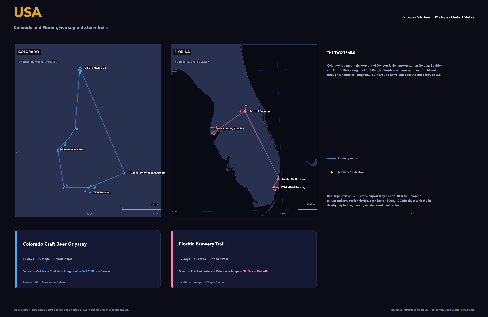
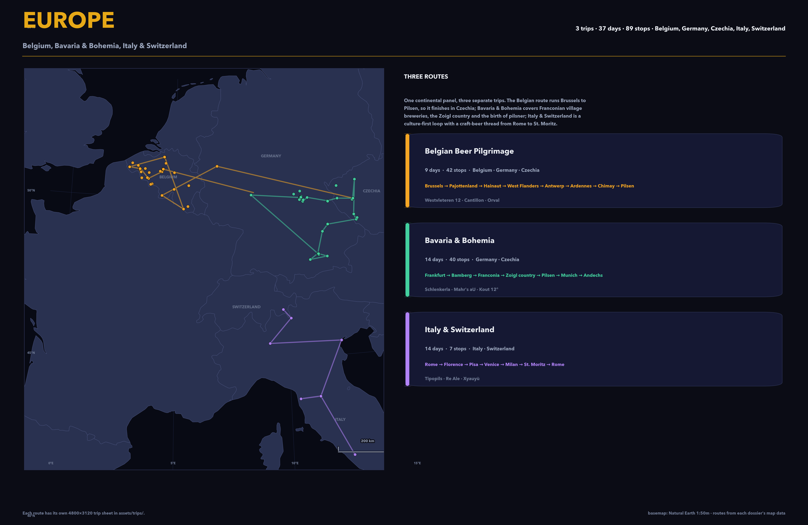
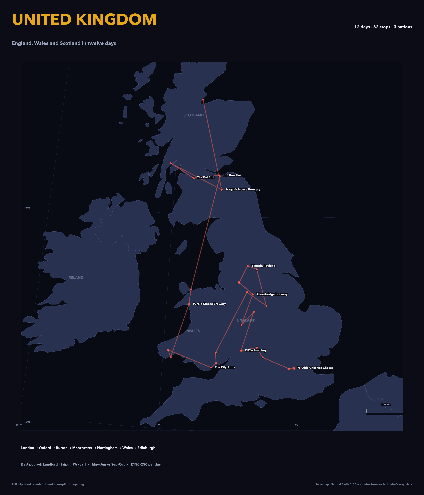
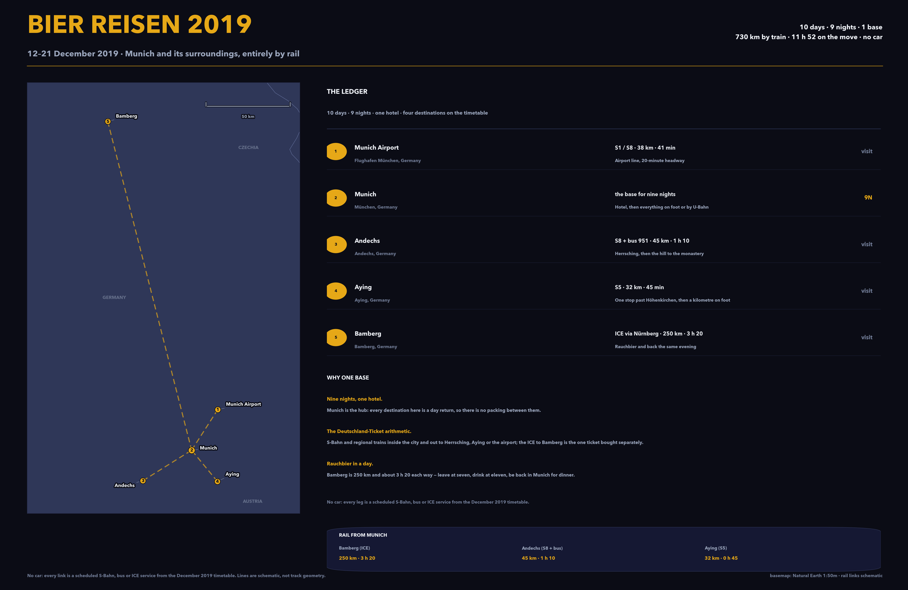
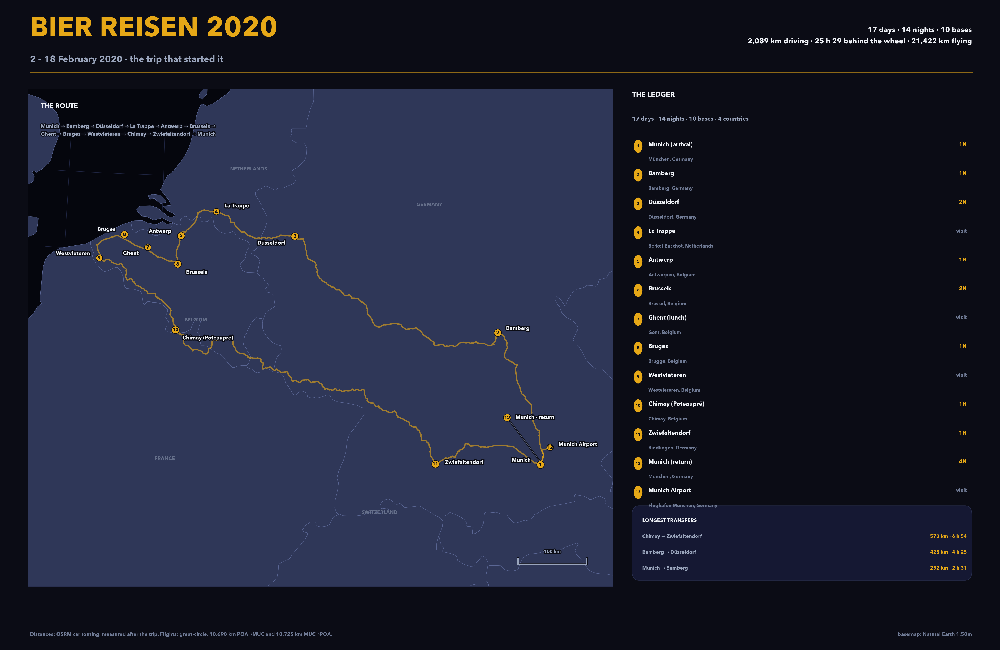
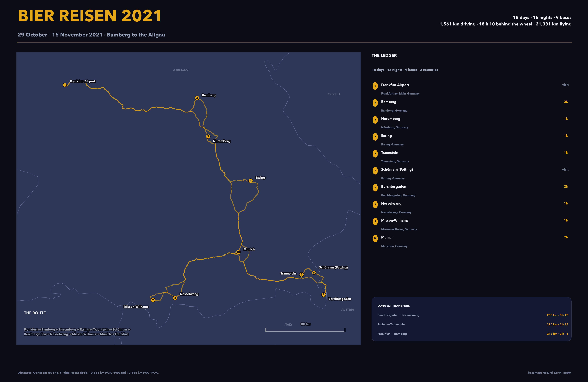
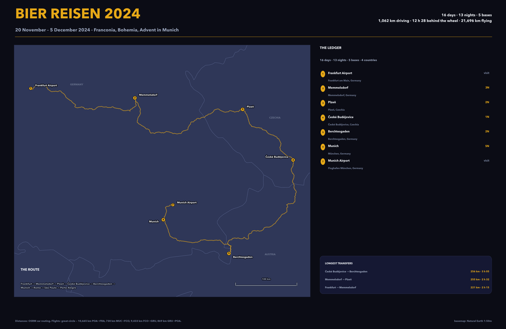
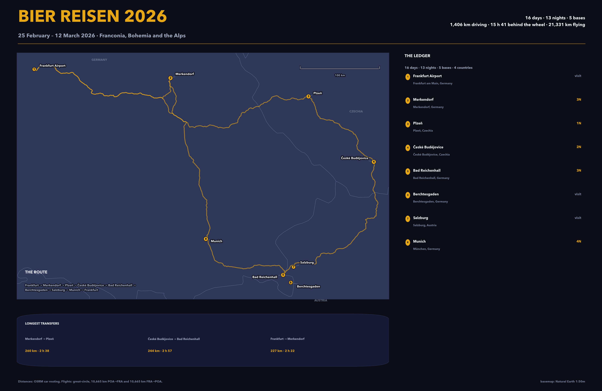

# 🍺 Bierreisen

Six AI-drafted beer pilgrimages — **73 days, 7 countries, 203 mapped stops** — collected in one place as self-contained HTML dossiers, plus regional maps that show where each one goes.

Every venue in the rankings, every day in the itinerary and every pin on the map links straight to Google Maps, opening in a new tab.

## Maps

Three regions, three posters. Splitting them out means each trail gets its own projection instead of being squeezed into one world view.

**USA — Colorado & Florida.** Two separate panels, because a single US frame turns both clusters into a smudge: Colorado is a mountain loop from Denver to Fort Collins, Florida a one-way drive from Miami to Dunedin.



**Europe — Belgium, Bavaria & Bohemia, Italy & Switzerland.** One continental panel, three routes in three colours — the Belgian trip finishes in Pilsen, the Franconian one covers the Zoigl country, the Italian one threads craft beer through Rome, Florence, Venice, Milan and St. Moritz.



**United Kingdom — England, Wales & Scotland.** All 32 stops from London to the Highlands, at a scale where each pub is a distinguishable dot.



*All six on one page: [overview poster](assets/beer-trips-map.png).*

## Trip maps

- [UK Beer Pilgrimage — 12 days, 32 stops](assets/trips/uk-beer-pilgrimage.png)
- [Belgian Beer Pilgrimage — 9 days, 42 stops](assets/trips/belgian-beer-pilgrimage.png)
- [Bavaria & Bohemia — 14 days, 40 stops](assets/trips/bavaria-bohemia.png)
- [Colorado Craft Beer Odyssey — 12 days, 39 stops](assets/trips/colorado-craft-beer.png)
- [Florida Brewery Trail — 12 days, 43 stops](assets/trips/florida-brewery-trail.png)
- [Italy & Switzerland Grand Tour — 14 days, 7 cities](assets/trips/italy-switzerland-grand-tour.png)
- [Italy & Switzerland Classic Loop — 14 days, 7 cities](assets/trips/italy-switzerland-classic.png)

Every trip below ships as a single HTML file: an interactive Leaflet map, a day-by-day flowchart, a ranked list of every brewery and pub, a beer table with style/ABV/IBU, and a tips tab. No build step, no server — open the file in a browser and it works offline apart from the map tiles.

---

## 2019 — Munich by rail



The first one, and the only one without a car: nine nights in a single Munich hotel, with Andechs, Aying and
Bamberg as day returns by S-Bahn and ICE. **10 days, 9 nights, 730 km by train.**

| Date | Where | The point of it |
|---|---|---|
| 12.12 | Munich Airport → city | Airbräu inside the terminal, then Augustiner at Marienplatz and Schneider Bräuhaus |
| 13.12 | Andechs | S8 to Herrsching, bus up the hill, monastery beer and the winter bier |
| 14.12 | Aying | S5 to Aying, a kilometre on foot to the Ayinger Bräustüberl |
| 15.12 | Munich | Augustiner, Hofbräuhaus, Schiller Bräu |
| 16.12 | Bamberg | ICE via Nuremberg — 250 km each way for Rauchbier |
| 17.12 | Munich | Tap House |
| 18.12 | Munich | Pfälzer Weinstube at Odeonsplatz — the one evening without beer |
| 19.12 | Munich | Giesinger Bräustüberl |
| 20.12 | Munich | free day |
| 21.12 | Munich → airport | S-Bahn out, Airbräu again, flight home |

- [`2019/2019-bier-reisen.html`](2019/2019-bier-reisen.html) — the dossier: itinerary, map, rankings, beer guide, rail times, suggestions
- [`2019/data/route-2019.json`](2019/data/route-2019.json) — every leg and stop, train services and timings
- [`2019/scripts/`](2019/scripts) — `build_html.py` and `make_route_map.py` regenerate the page and the poster

## 2020 — the trip that started it



The original: 17 days in February 2020, from Porto Alegre to Bavaria, the Rhineland, the Belgian
Trappists and back. 14 nights, 10 bases, **2,089 km behind the wheel** and 21,422 km in the air.

| Dates | Base | Nights |
|---|---|---|
| 03.02 | Munich — Hotel Royal | 1 |
| 04.02 | Bamberg — Ibis Styles | 1 |
| 05–06.02 | Düsseldorf — Altstadt Hotel Rheinblick | 2 |
| 07.02 | Antwerp — Hotel Banks (via La Trappe) | 1 |
| 08–09.02 | Brussels — Ibis Brussels City Centre | 2 |
| 10.02 | Bruges — Martin's Brugge (lunch in Ghent) | 1 |
| 11.02 | Chimay — Auberge de Poteaupré (via Westvleteren) | 1 |
| 12.02 | Zwiefaltendorf — Bauer am Bach (dinner at Blank's) | 1 |
| 13–16.02 | Munich — Hotel Royal | 4 |

- [`2020/2020-bier-reisen.html`](2020/2020-bier-reisen.html) — the dossier: itinerary, map, rankings, beer guide, drive times, suggestions
- [`2020/data/route-2020.json`](2020/data/route-2020.json) — every leg, every stop, OSRM distances
- [`2020/scripts/`](2020/scripts) — `build_html.py` and `make_route_map.py` regenerate the page and the poster

## 2021 — Bamberg to the Allgäu



18 days, 29 October – 15 November 2021. Land in Frankfurt and drive straight to Franconia, then south
along the Danube gorge, across the Chiemgau to Berchtesgaden, west through the Allgäu, and seven nights
in Munich before the long drive back to Frankfurt. **16 nights, 9 bases, 1,561 km behind the wheel.**

| Dates | Base | Nights | Stay |
|---|---|---|---|
| 30–31.10 | Bamberg | 2 | Hotel Andres, Heiliggrabstr. 1 |
| 01.11 | Nuremberg | 1 | Leonard Hotel, Zufuhrstraße 22 |
| 02.11 | Essing | 1 | Gasthaus Felsenwastl, Unterer Markt 19 |
| 03.11 | Traunstein | 1 | Hotel Rosenheimer Hof, Rosenheimer Str. 58 |
| 04–05.11 | Berchtesgaden | 2 | Alpensport-Hotel Seimler, Maria am Berg 3–5 |
| 06.11 | Nesselwang | 1 | Brauerei-Gasthof Hotel Post, Hauptstraße 25 |
| 07.11 | Missen-Wilhams | 1 | Brauereigasthof Schäffler, Hauptstraße 15 |
| 08–14.11 | Munich | 7 | Hotel Italia, Schillerstr. 19 |

- [`2021/2021-bier-reisen.html`](2021/2021-bier-reisen.html) — the dossier: itinerary, map, rankings, beer guide, drive times, suggestions
- [`2021/data/route-2021.json`](2021/data/route-2021.json) — every leg, every stop, OSRM distances
- [`2021/scripts/`](2021/scripts) — `build_html.py` and `make_route_map.py` regenerate the page and the poster

## 2024 — Franconia, Bohemia and Advent in Munich



16 days, 20 November – 5 December 2024. Land in Frankfurt and drive to Memmelsdorf, six kilometres from
Bamberg, for three nights between two village breweries. Then Plzeň for the pilsner, České Budějovice for
Budvar, two nights under the Watzmann, and five in Munich as the Christmas markets open. Home via Rome and
São Paulo. **13 nights, 5 bases, 1,062 km behind the wheel.**

| Dates | Base | Nights |
|---|---|---|
| 21–23.11 | Memmelsdorf, near Bamberg | 3 |
| 24–25.11 | Plzeň | 2 |
| 26.11 | České Budějovice | 1 |
| 27–28.11 | Berchtesgaden | 2 |
| 29.11–03.12 | Munich | 5 |

- [`2024/2024-bier-reisen.html`](2024/2024-bier-reisen.html) — the dossier: itinerary, map, rankings, beer guide, drive times, suggestions
- [`2024/data/route-2024.json`](2024/data/route-2024.json) — every leg, every stop, OSRM distances
- [`2024/scripts/`](2024/scripts) — `build_html.py` and `make_route_map.py` regenerate the page and the poster

## 2026 — Franconia, Bohemia and the Alps



16 days, 25 February – 12 March 2026. Land in Frankfurt and drive to Merkendorf, the village of Brauerei
Wagner eight kilometres from Bamberg, for three nights. Then Plzeň for the pilsner, two nights of Budvar in
České Budějovice, three Alpine nights in Bad Reichenhall with Berchtesgaden and Salzburg a short drive away,
and four nights in Munich. **13 nights, 5 bases, 1,406 km behind the wheel.**

| Dates | Base | Nights |
|---|---|---|
| 26–28.02 | Merkendorf, near Bamberg | 3 |
| 01.03 | Plzeň | 1 |
| 02–03.03 | České Budějovice | 2 |
| 04–06.03 | Bad Reichenhall | 3 |
| 07–10.03 | Munich | 4 |

- [`2026/2026-bier-reisen.html`](2026/2026-bier-reisen.html) — the dossier: itinerary, map, rankings, beer guide, drive times, suggestions
- [`2026/data/route-2026.json`](2026/data/route-2026.json) — every leg, every stop, OSRM distances
- [`2026/scripts/`](2026/scripts) — `build_html.py` and `make_route_map.py` regenerate the page and the poster

## Contents

- [Maps](#maps)
- [2019 — Munich by rail](#2019--munich-by-rail)
- [2020 — the trip that started it](#2020--the-trip-that-started-it)
- [2021 — Bamberg to the Allgäu](#2021--bamberg-to-the-allgäu)
- [2024 — Franconia, Bohemia and Advent in Munich](#2024--franconia-bohemia-and-advent-in-munich)
- [2026 — Franconia, Bohemia and the Alps](#2026--franconia-bohemia-and-the-alps)
- [The six trips at a glance](#the-six-trips-at-a-glance)
- [1. UK Beer Pilgrimage — 12 days](#1-uk-beer-pilgrimage--12-days)
- [2. Belgian Beer Pilgrimage — 9 days](#2-belgian-beer-pilgrimage--9-days)
- [3. Bavaria & Bohemia — 14 days](#3-bavaria--bohemia--14-days)
- [4. Colorado Craft Beer Odyssey — 12 days](#4-colorado-craft-beer-odyssey--12-days)
- [5. Florida Brewery Trail — 12 days](#5-florida-brewery-trail--12-days)
- [6. Italy & Switzerland — 14 days](#6-italy--switzerland--14-days)
- [Choosing a trip](#choosing-a-trip)
- [Repository layout](#repository-layout)
- [Regenerating the map](#regenerating-the-map)
- [Notes on accuracy](#notes-on-accuracy)

---

## The six trips at a glance

| # | Trip | Days | Where | Mapped stops | Signature pour | Best window | Dossier |
|---|------|-----:|-------|-----:|----------------|-------------|---------|
| 1 | UK Beer Pilgrimage | 12 | England · Wales · Scotland | 32 | Cask ale — Landlord, Jaipur IPA, Jarl | May–Jun, Sep–Oct | [`uk_beer_trip.html`](AI-suggested-trips/uk_beer_trip.html) |
| 2 | Belgian Beer Pilgrimage | 9 | Belgium · Germany · Czechia | 42 | Westvleteren 12, Cantillon Gueuze, Orval | Apr–Jun, Sep–Oct | [`belgian.html`](AI-suggested-trips/belgian.html) |
| 3 | Bavaria & Bohemia | 14 | Germany · Czechia | 40 | Schlenkerla Rauchbier, Mahr's aU, Kout 12° | May–Sep | [`germany_czech_beer_trip.html`](AI-suggested-trips/germany_czech_beer_trip.html) |
| 4 | Colorado Craft Beer Odyssey | 12 | United States | 39 | Bierstadt slow-pour Pils, Funkwerks Saison | Jun–Sep | [`colorado_beer_trip.html`](AI-suggested-trips/colorado_beer_trip.html) |
| 5 | Florida Brewery Trail | 12 | United States | 43 | Jai Alai IPA, Hunahpu's, Maple Bacon Coffee Porter | Nov–Apr | [`florida_brewery_trip.html`](AI-suggested-trips/florida_brewery_trip.html) |
| 6 | Italy & Switzerland | 14 | Italy · Switzerland | 7 cities · 22+ beer venues | Tipopils, Re Ale, Xyauyù | May–Jun, Sep–Oct | [`Italy_Switzerland_14Day_Trip.html`](AI-suggested-trips/Italy_Switzerland_14Day_Trip.html) |

*Mapped stops = markers in each dossier's Leaflet map. Belgium's dossier starts in Frankfurt and finishes in Pilsen, so it covers three countries; Italy & Switzerland is mapped at city level, but names 22+ craft-beer venues across those cities.*

---

## 1. UK Beer Pilgrimage — 12 days

**England · Wales · Scotland · 32 ranked pubs & breweries**
[`uk_beer_trip.html`](AI-suggested-trips/uk_beer_trip.html)

The classic cask-ale education: medieval taverns carved into castle rock, Victorian tower breweries still running on steam, and the modern craft wave that grew out of Bermondsey railway arches. Two days in London, then a loop north through the Midlands and Yorkshire, west into Wales, and up to Scotland.

**Route:** London → Oxford & the Cotswolds → Burton-on-Trent → Manchester & Yorkshire → Nottingham → Abergavenny → Pembrokeshire → Snowdonia → Edinburgh → Glasgow & Loch Fyne → the Highlands

| Day | Where | Don't miss |
|----:|-------|------------|
| 1 | Denver → London | Ye Olde Cheshire Cheese (1667, Dickens' local); The Prospect of Whitby (1520, riverside) |
| 2 | London craft & heritage | The Kernel, Bermondsey Beer Mile; Fuller's Griffin Brewery, Chiswick; The Lamb's Victorian snob screens |
| 3 | Oxford & Cotswolds | The Eagle and Child (Tolkien's "Bird and Baby"); Hook Norton's steam-powered tower brewery; DEYA in Cheltenham |
| 4 | Burton-on-Trent & Black Country | Burton Bridge (the water that made pale ale); The Olde Swan "Ma Pardoe's" (1835 homebrew pub); Thornbridge, Bakewell |
| 5 | Manchester & Yorkshire | Marble Arch Inn; Cloudwater's Piccadilly taproom; Timothy Taylor's; Northern Monk, Leeds |
| 6 | Nottingham → Wales | Ye Olde Trip to Jerusalem (1189, in the castle rock); Buxton Brewery; afternoon drive to Abergavenny |
| 7 | Abergavenny & South Wales | Skirrid Mountain Inn (~1110, hanging beam and all); Tiny Rebel, Newport; The City Arms, Cardiff |
| 8 | Pembrokeshire | Bluestone Brewing (Preseli Hills spring water); Tenby Brewing's harbour taproom; the coast path |
| 9 | Snowdonia & North Wales | Purple Moose, Porthmadog; Ye Olde Bull's Head, Beaumaris (1472) |
| 10 | Edinburgh | The Sheep Heid Inn (1360, royal skittles alley); The Bow Bar; Barney's Beer at Summerhall; The Cloisters |
| 11 | Glasgow & Loch Fyne | The Pot Still (700+ whiskies); WEST Brewery in the Venetian Gothic Templeton building; Fyne Ales |
| 12 | Highlands & home | Traquair House (brewing since 1566); Cromarty on the Black Isle; fly Edinburgh → Denver |

**Top five:** Ye Olde Trip to Jerusalem (1189) · The Sheep Heid Inn (1360) · Ye Olde Cheshire Cheese (1667) · Skirrid Mountain Inn (~1110) · Cloudwater Brew Co

**Drink this:** Timothy Taylor Landlord, Thornbridge Jaipur IPA, Fyne Ales Jarl, Tiny Rebel CWTCH, Fuller's London Pride.

**Practical:** ask for a *half* if you want to try many; "cask" means handpump, cellar temperature, low carbonation — try the same beer on keg for contrast. CAMRA-listed pubs guarantee well-kept ale. Tipping at the bar isn't expected. Days 1–2 are Tube-only, then pick up a car on Day 3 — left-hand driving, and designate a driver on brewery days. Budget ≈ **£150–250/day**.

---

## 2. Belgian Beer Pilgrimage — 9 days

**Belgium · Germany · Czechia · 42 stops**
[`belgian.html`](AI-suggested-trips/belgian.html)

Nine days through the most densely beered country on earth, starting in Frankfurt and ending with a plot twist: the last day drives to Pilsen, where pilsner was invented. Between those bookends: spontaneous fermentation in Brussels, saison farmhouses in Hainaut, Flemish red in Roeselare, Trappist abbeys, and a lot of very old cafés.

**Route:** Brussels → Pajottenland → Hainaut → West Flanders → Bruges → Westvleteren & Antwerp → Ardennes → Chimay → Cologne → Pilsen

| Day | Where | Don't miss |
|----:|-------|------------|
| 1 | Frankfurt → Brussels | Cantillon (the last traditional lambic brewery in the city); Moeder Lambic; A la Mort Subite (1928 Art Deco) |
| 2 | Pajottenland lambic trail | Drie Fonteinen's Lambik-O-Droom; Lindemans; Brasserie de la Senne; Au Bon Vieux Temps |
| 3 | Hainaut | Brasserie Dupont (Saison Dupont); Brasserie à Vapeur — a steam-powered brewery open one Saturday a month; Blaugies |
| 4 | West Flanders | Rodenbach's 200 oak foeders; De Dolle Brouwers; De Ranke; 't Verzet; De Halve Maan and its beer pipeline |
| 5 | Bruges | De Garre (house tripel, max three per person); 't Brugs Beertje; Café Vlissinghe (1515) |
| 6 | Trappist trail & Antwerp | In de Vrede — the only place to drink Westvleteren 12 on tap; Het Anker, Mechelen; Kulminator's vintage cellar |
| 7 | Ardennes | Orval (one beer, brett-aged); Brasserie Fantôme (Saturdays, when Dany feels like it); Caracole's wood-fired kettles |
| 8 | Chimay → Germany | Chimay's Scourmont Abbey; Ellezelloise; then Kölsch houses in Cologne (Päffgen, Früh am Dom) |
| 9 | Cologne → Pilsen | Pilsner Urquell's cellars; Na Parkánu tank beer; Purkmistr; Pivovar Raven; U Salzmannů (1637) |

**Top five:** Westvleteren 12 · Cantillon · Drie Fonteinen · Brasserie Dupont · Rodenbach

**Drink this:** Westvleteren 12 (10.2%), Cantillon Gueuze, Orval, Saison Dupont, Rodenbach Grand Cru, De Dolle Stille Nacht.

**Practical:** brewery tours are appointment-only at Dupont, Blaugies and De Ranke — email weeks ahead. Westvleteren sells through a lottery/reservation system; In de Vrede is the reliable pour. Fantôme and à Vapeur keep eccentric hours; check before you drive. Belgium is compact but the Ardennes legs are slow — plan two hours between stops.

---

## 3. Bavaria & Bohemia — 14 days

**Germany · Czechia · 40 ranked breweries · ~45 stops on the route**
[`germany_czech_beer_trip.html`](AI-suggested-trips/germany_czech_beer_trip.html)

The deepest beer trip in the collection. Franconia alone has more breweries per capita than anywhere on earth, and this route walks between them: village brewhouses, hillside beer cellars under chestnut trees, the communal *Zoigl* tradition, then over the border into Bohemia for tank pilsner, hop country and the birth of the golden lager.

**Route:** Frankfurt → Bamberg → Franconian villages → Aufseß → Zoigl country → Chodová Planá → Pilsen → Žatec → Šumava → Regensburg → Munich → Andechs

| Day | Where | Don't miss |
|----:|-------|------------|
| 1 | Frankfurt → Bamberg | Schlenkerla — beechwood-smoked Märzen from oak barrels, in a medieval vaulted cellar |
| 2 | Bamberg crawl | Spezial (the locals' rauchbier); Mahr's Bräu "aU" Ungespundetes; Fässla; Greifenklau's beer garden; Klosterbräu (1533) |
| 3 | Franconian villages, north | Drei Kronen Memmelsdorf; Wagner and Hummel in Merkendorf; Knoblach farm brewery — walk the Brauereienweg |
| 4 | Hallerndorf & south | Rittmayer's hillside cellars; Lieberth; Griess in Geisfeld; St. Georgen, Buttenheim |
| 5 | Aufseß & Upper Franconia | Four breweries for 1,500 people (a Guinness record); Trunk at Vierzehnheiligen basilica; Göller, Zeil am Main |
| 6 | Zoigl country | Windischeschenbach and Neuhaus — look for the six-pointed star meaning "beer is on today" |
| 7 | Into Bohemia | Pivovar Chodovar's 500-year-old beer caves and beer spa; evening tank pilsner in Pilsen |
| 8 | Pilsen | Pilsner Urquell tour with unfiltered tasting from oak; U Salzmannů; Purkmistr; Raven |
| 9 | Žatec & Kout | The hop capital's Hop Museum; Falkon brewing metres from the hop fields; Kout na Šumavě's cult 12° lager |
| 10 | Šumava forest | Zhůřák (tiny, remote, wood-fired); Svatý Florian; Permon in mining country |
| 11 | Back to Bavaria | Kneitinger in Regensburg (1530); Spitalbrauerei on the Stone Bridge; Kuchlbauer's Hundertwasser tower |
| 12 | Munich | Augustiner-Keller's wooden-barrel Edelstoff; Schneider Bräuhaus; Giesinger; ORCA; Hofbräuhaus for the spectacle |
| 13 | Andechs & Grafing | Kloster Andechs Doppelbock Dunkel above the Ammersee; Wildbrau on Grafing's market square |
| 14 | Munich → home | Final Weißwurst breakfast before noon, then the train to Frankfurt |

**Top five:** Schlenkerla · Mahr's Bräu · Pivovar Kout na Šumavě · Pilsner Urquell · Augustiner-Keller

**Drink this:** Schlenkerla Märzen Rauchbier, Mahr's aU, Kout 12°, Pilsner Urquell from a tank, Andechs Doppelbock, Aventinus.

**Practical:** the Bavaria Ticket covers unlimited regional trains for €29/day and is often better than driving; Franconian brewery trails are hiking routes, so don't drive between village stops. In Czechia a pint costs €1.50–2.50 — order *čepované* (draft). Zoigl houses open on scheduled days only; check the calendar. May–September is beer-garden season; Annafest in Hallerndorf (late July) opens 23 cellars at once.

---

## 4. Colorado Craft Beer Odyssey — 12 days

**United States · 39 mapped stops · 34 ranked**
[`colorado_beer_trip.html`](AI-suggested-trips/colorado_beer_trip.html)

Denver's RiNo district packs a dozen taprooms into a few walkable blocks, Golden 25 minutes west calls itself the brewery capital per capita, and this route works outward from there to Boulder, Longmont and Fort Collins — from metal-and-sour taprooms to a brewery that only makes four German lagers and does them perfectly.

**Route:** Denver (RiNo, SoBo, Baker) → Golden → Boulder → Niwot & Longmont → Fort Collins → Denver

| Day | Where | Don't miss |
|----:|-------|------------|
| 1 | Arrival — Denver | Wynkoop (Colorado's first brewpub, 1988); Great Divide Barrel Bar; take the A-Line from DEN |
| 2 | RiNo & Five Points | Ratio Beerworks; Our Mutual Friend; Bierstadt's five-minute slow-pour Pils; Epic's barrel-aged beers |
| 3 | South Broadway & Baker | TRVE (metal + wild ales); Baere; Falling Rock Tap House — 75+ taps, GABF HQ since 1997 |
| 4 | Denver hidden gems | Cerebral's hazy IPAs; Westfax lagers; Cohesion's Czech styles |
| 5 | Golden | Coors tour (free, enormous); Golden City Brewery's backyard; Cannonball Creek; Lookout Mountain hike |
| 6 | Golden → Boulder | New Terrain; Holidaily (100% gluten-free); scenic Highway 93 |
| 7 | Boulder — Pearl Street | Mountain Sun (cash only, no TVs, FYIPA); Avery's 67 taps; Upslope; The Sink (1923) |
| 8 | Boulder east side | Wild Woods (spruce-tip beers); Sanitas; Finkel & Garf; hike Mt Sanitas first |
| 9 | Niwot & Longmont | Fritz Family Brewers; Left Hand's Nitro Milk Stout; Wibby (lagers only); 300 Suns |
| 10 | Fort Collins — Old Town | New Belgium tour (book ahead); Odell; Coopersmith's; The Mayor of Old Town's 100 Colorado taps |
| 11 | Fort Collins deep cuts | Funkwerks saisons; Horse & Dragon; Zwei; Purpose — Peter Bouckaert's tiny passion project |
| 12 | Departure | Snowbank morning stout; Denver Beer Co; Argonaut bottle shop; fly out of DEN |

**Top five:** Funkwerks · Avery · Odell · Purpose · Great Divide

**Drink this:** Bierstadt slow-pour Pils, Funkwerks Saison, Odell IPA, Left Hand Nitro Milk Stout, Avery's barrel series (Tweak, Rumpkin).

**Practical:** the A-Line train runs DEN → Union Station for $10.50; RiNo is walkable from there. You need a car for Golden/Boulder/Fort Collins, but not for the Denver days. Mountain Sun is cash-only. Book the New Belgium tour in advance. September means GABF and big crowds.

---

## 5. Florida Brewery Trail — 12 days

**United States · 43 mapped stops · 35 ranked**
[`florida_brewery_trip.html`](AI-suggested-trips/florida_brewery_trip.html)

A one-way drive from Miami to Tampa Bay through the state's craft-beer triangle: pastry stouts and smoothie sours in Wynwood, a theme-park-free Orlando beer corridor, and Tampa's heavyweight reputation — Cigar City, Angry Chair, and a St. Pete barrel-aging scene that trades like rare bourbon.

**Route:** Miami (Wynwood, Doral, Coral Gables) → Fort Lauderdale → Orlando → Tampa (Seminole Heights, Ybor) → St. Pete → Dunedin → TPA

| Day | Where | Don't miss |
|----:|-------|------------|
| 1 | Miami — Wynwood | The Tank (five minutes from MIA); J Wakefield's pastry stouts; Veza Sur; the Wynwood art walk |
| 2 | Doral deep cuts | Tripping Animals (smoothie sours that sell out); MIA Beer Co; Spanish Marie; Unseen Creatures (foraged yeast) |
| 3 | Coral Gables & Miami Beach | Titanic (Miami's oldest brewpub, 1997); Abbey Brewing; South Beach; Boxelder bottle shop |
| 4 | Fort Lauderdale → Orlando | Funky Buddha (Maple Bacon Coffee Porter); LauderAle; Riverside Market's 300 bottles; 3.5h drive north |
| 5 | Orlando — Mills 50 | Ten10; Sideward's sour program; Ocean Sun; Redlight Redlight (no TVs, 30+ rare taps) |
| 6 | Ivanhoe & College Park | Ivanhoe Park's gold-medal Pilsner; Bowigens; Tactical; Braveheart Pub's real ales |
| 7 | Orlando — SODO | Rockpit (brewery + distillery); Dead Lizard; Orange County Brewers; Wops Hops in a 1920s building |
| 8 | Winter Park & Winter Garden | The Ravenous Pig (James Beard nominee, on-site brewery); Toll Road; Crooked Can in Plant Street Market |
| 9 | Tampa — Seminole Heights | Cigar City (Jai Alai); Angry Chair's German Chocolate Cupcake Stout; Hidden Springs; Penelope |
| 10 | Ybor City & Tampa Heights | Coppertail; Tampa Bay Brewing (1995); Magnanimous; The Independent; Cuban sandwiches in Ybor |
| 11 | St. Petersburg | Cycle's barrel-aged stouts (go early); Green Bench + Webb's City Cellar; 3 Daughters; St. Pete Beach sunset |
| 12 | Dunedin & departure | Dunedin Brewery (Florida's oldest micro, 1996); Arkane Aleworks; Motorworks; fly out of TPA |

**Top five:** Cigar City · Angry Chair · J Wakefield · Tripping Animals · Cycle Brewing

**Drink this:** Jai Alai IPA, Hunahpu's, Maple Bacon Coffee Porter, German Chocolate Cupcake Stout, Cycle's barrel-aged stouts.

**Practical:** rent at MIA, return at TPA (one-way is common). Never drive after a crawl — rideshare. Miami → Orlando is ~3.5h via the Turnpike; Orlando → Tampa ~1.5h on I-4, which is reliably congested. Follow breweries on Instagram for can releases; Cycle has very limited seating. Budget ≈ **$3,500–5,500** for 12 days excluding flights.

---

## 6. Italy & Switzerland — 14 days

**Italy · Switzerland · 7 cities · 22+ beer venues**
[`Italy_Switzerland_14Day_Trip.html`](AI-suggested-trips/Italy_Switzerland_14Day_Trip.html) · alternate order: [`italy_switzerland_trip.html`](AI-suggested-trips/italy_switzerland_trip.html)

A culture-first grand tour with a craft-beer thread running through it: Rome's Trastevere beer bars, Florence's brewpub, Pisa's Orzo Bruno, the Navigli aperitivo, and a Bernina Express ride into the Engadin — where the local brewery sits above 1,700 m. Two versions of the itinerary exist; the "Grand Tour" file puts Venice before Milan and ends with two more nights in Rome.

**Route (Grand Tour):** Rome → Florence → Pisa (day trip) → Venice → Milan → St. Moritz → Rome

| Day | Where | Don't miss |
|----:|-------|------------|
| 1 | Rome | Trastevere or Monti; passeggiata, then dinner at Da Enzo al 29 |
| 2 | Ancient Rome | Colosseum + Forum + Palatine; San Clemente's three layers; Capitoline Museums |
| 3 | Vatican & Trastevere | St. Peter's at 7:30; Castel Sant'Angelo; Pantheon; beer at Ma Che Siete Venuti a Fà |
| 4 | Rome → Florence | Duomo climb; Uffizi in the afternoon; Negroni where it was invented |
| 5 | Florence | Accademia (David); San Marco frescoes; Mercato Centrale; Archea Brewery in Oltrarno |
| 6 | Florence & Pisa | Brancacci Chapel; afternoon in Pisa — Camposanto, the Tower, Keith Haring's last mural, Orzo Bruno |
| 7 | Florence → Venice | San Marco and the Doge's Palace (Secret Itineraries); sunset at Zattere; cicchetti |
| 8 | Venice | Torcello and Burano in the morning; Jewish Ghetto, Scala del Bovolo, Frari; bacaro crawl in Cannaregio |
| 9 | Venice → Milan | Duomo rooftop; Galleria; The Last Supper (pre-booked); aperitivo on the Navigli |
| 10 | Milan | Sforza Castle; San Maurizio's frescoes; Brera; Birrificio Lambrate in the evening |
| 11 | Milan → St. Moritz | Bernina Railway (UNESCO, book the panoramic car); lake walk; Segantini Museum |
| 12 | Engadin | Muottas Muragl at sunrise; Sils Maria and Nietzsche's house; Val Fex; Zuoz's sgraffito houses |
| 13 | St. Moritz → Rome | Appian Way bike ride; Testaccio Market; Protestant Cemetery at sunset |
| 14 | Rome & departure | Borghese Gallery (morning slot); Quartiere Coppedè; Aventine keyhole; fly from FCO |

**Top five beer stops:** Open Baladin (Rome) · Ma Che Siete Venuti a Fà (Rome) · Birra Più (Rome) · Brasserie 4:20 (Rome) · Birra del Borgo — plus Archea in Florence, Orzo Bruno in Pisa, Birrificio Lambrate in Milan and Il Santo Bevitore in Venice.

**Drink this:** Tipopils (the beer that invented Italian pilsner), Re Ale, Xyauyù, Archea Dubbel, Baladin Nazionale.

**Practical:** book the Last Supper 2–3 months ahead — non-negotiable; Colosseum Underground 3–4 weeks; Uffizi and the Vatican 1–2 weeks. Trains: Frecciarossa fares double if you book late. Bernina Express panoramic car 2–3 weeks ahead. Budget ≈ **€2,500–4,000** per person excluding flights.

---

## Choosing a trip

- **Cask ale and old pubs** → UK. The only trip where the buildings are half the attraction (1189, 1360, 1520, 1667).
- **Greatest beer density, least driving** → Belgium. 42 stops in 9 days, mostly train-friendly, and it ends in Pilsen.
- **Best value and most depth** → Bavaria & Bohemia. Village breweries at €2 a half-litre, plus the two most influential lager traditions in the world.
- **Haze, pastry stouts and taproom culture** → Colorado or Florida. Colorado for variety and scenery; Florida for the barrel-aged whales and a beach.
- **Non-beer travel companions** → Italy & Switzerland. World-class museums and mountains with 26 beer venues as the counterpoint.
- **No car at all** → Belgium (train + taxi) or Italy (Frecciarossa + Bernina). The US trips and the UK's middle days need wheels.

**Seasonality:** May–June and September–October win nearly everywhere — beer gardens open, no August heat, fewer crowds. Florida inverts it: go November–April. September adds GABF to Colorado and the Edinburgh Fringe to the UK in August.

---

## Repository layout

```
bierreisen/
├── AI-suggested-trips/
│   ├── uk_beer_trip.html                  # 12 days, 32 stops
│   ├── belgian.html                       # 9 days, 42 stops
│   ├── germany_czech_beer_trip.html       # 14 days, 40 stops
│   ├── colorado_beer_trip.html            # 12 days, 39 stops
│   ├── florida_brewery_trip.html          # 12 days, 43 stops
│   ├── Italy_Switzerland_14Day_Trip.html  # 14 days, Grand Tour order
│   └── italy_switzerland_trip.html        # 14 days, alternate order
├── assets/
│   ├── beer-trips-map.png                 # the poster above
│   ├── trips.json                         # extracted stops + routes
│   ├── ne_50m_countries.geojson           # Natural Earth 1:50m basemap
│   └── us_states.geojson                  # US state lines for the NA panel
├── assets/maps/                           # regional posters (README hero)
│   ├── usa.png · europe.png · uk.png
├── 2019/                                  # Munich by rail, the first trip
│   ├── 2019-bier-reisen.html
│   ├── assets/2019-route-map.png
│   ├── data/route-2019.json
│   └── scripts/
├── 2020/                                  # the first trip, as it happened
│   ├── 2020-bier-reisen.html
│   ├── assets/2020-route-map.png
│   ├── data/route-2020.json
│   └── scripts/                           # build_html.py, make_route_map.py
├── 2021/                                  # the second trip, same layout
│   ├── 2021-bier-reisen.html
│   ├── assets/2021-route-map.png
│   ├── data/route-2021.json
│   └── scripts/
├── 2024/                                  # the third trip, same layout
│   ├── 2024-bier-reisen.html
│   ├── assets/2024-route-map.png
│   ├── data/route-2024.json
│   └── scripts/
├── 2026/                                  # the fourth trip, same layout
│   ├── 2026-bier-reisen.html
│   ├── assets/2026-route-map.png
│   ├── data/route-2026.json
│   └── scripts/
├── 2027/                                  # the next one, three variants
│   ├── 2027-bier-reisen.html              # v1
│   ├── v2/ · v3/
│   ├── data/ · assets/ · scripts/ · i18n/
└── scripts/
    ├── extract_trips.py                   # dossiers → trips.json
    ├── make_map.py                        # trips.json → overview poster
    └── make_region_maps.py                # trips.json → USA / Europe / UK
```

Each dossier is a single HTML file with four or five tabs: **Flowchart** (day-by-day), **Map** (Leaflet, dark tiles), **Rankings** (every place, scored), **Beer guide** (style, ABV, IBU, colour) and **Tips** (transport, lodging, budget, season).

---

## Regenerating the map

The poster is generated, not hand-drawn. It reads each dossier's own Leaflet marker arrays, so editing a trip file and re-running the script updates the map.

```bash
python3 -m pip install matplotlib numpy beautifulsoup4 lxml

python3 scripts/extract_trips.py     # AI-suggested-trips/*.html → assets/trips.json
python3 scripts/make_map.py          # assets/trips.json → assets/beer-trips-map.png
```

`make_map.py` lays out a header, two Lambert-conformal panels (North America and Europe), a Denver zoom inset, and six trip cards. Colours, panel windows and card copy live at the top of the file in `COLORS`, `PANELS`, `LABELS` and `CARD_TEXT`.

### Rebuilding a year dossier

Each `<year>/` folder is self-contained. The 2027 planner has one extra step, because its
language switcher is layered on afterwards:

```bash
python3 2027/scripts/build_html.py                # v1 (add --variant v2|v3 for the others)
python3 2027/scripts/add_i18n.py v1 v2 v3         # REQUIRED: rebuilds above wipe the switcher
```

`build_html.py` writes plain English HTML — running it without `add_i18n.py` leaves the page with
no EN/PT/DE chips. The 2019–2026 dossiers have no i18n layer, so `build_html.py` alone is enough.

---

## Notes on accuracy

- Every dossier is an **AI-generated planning draft**. Opening hours, tour schedules and prices change — verify before booking, especially for appointment-only breweries (Dupont, Blaugies, De Ranke) and lottery-based releases (Westvleteren).
- Coordinates come from the dossiers' own map data and are approximate to street level, not door level.
- Budget lines are the dossiers' own estimates: UK £150–250/day, Florida $3,500–5,500 total, Italy €2,500–4,000 total. Trips without a figure simply don't state one.
- "Kout na Šumavě" style cult places keep erratic hours by design. That's part of the trip, but build slack into the day.
